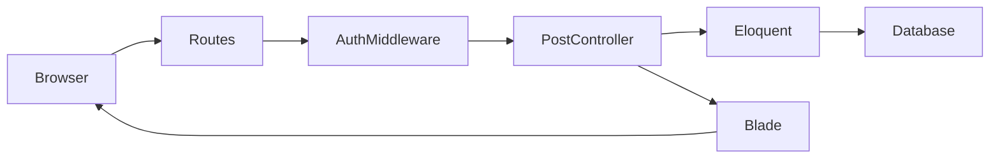

# Laravel Blog Application

## Overview

A server-rendered blog prototype built with Laravel and Blade. It demonstrates authentication, database migrations, and resource-controller CRUD for posts. It is intended as a learning project rather than a production-ready publishing service.

## Features and architecture

- Laravel UI authentication scaffolding.
- Post listing, creation, display, editing and deletion routes.
- Title and description validation in the post controller.
- Relational posts/users schema with a required user foreign key.
- Blade templates and Vite-managed frontend assets.



## Technology stack

| Technology | Declared constraint | Locked version |
|---|---|---|
| PHP | ^8.1 | Runtime not pinned |
| Laravel | ^10.0 | 10.48.25 |
| Laravel UI | ^4.6 | 4.6.1 |
| Laravel Sanctum | ^3.2 | 3.3.3 |
| PHPUnit | ^10.0 | 10.5.38 |
| Vite | ^4.0 | 4.5.9 |
| Laravel Vite plugin | See package.json | 0.7.8 |
| Bootstrap | See package.json | 5.3.3 |
| Sass | See package.json | 1.83.4 |
| Axios | See package.json | 1.7.9 |

The lockfiles are the source of truth for transitive dependencies.

## Prerequisites

PHP 8.1 or a compatible later 8.x release, Composer, Node.js/npm (a supported LTS release compatible with Vite 4), and a database with its PHP PDO driver. The default database connection is MySQL. PHP extensions required by Laravel and Composer must be available.

## Project structure

- `app/Http/Controllers/PostController.php` — post actions.
- `app/Models/Post.php` — Eloquent post model.
- `routes/web.php` — web and authentication routes.
- `database/migrations/` — database schema.
- `resources/views/` — Blade views.
- `tests/` — PHPUnit scaffolding.
- `composer.json`, `composer.lock`, `package.json`, `package-lock.json` — dependency definitions.

## Installation and setup

**Current blocker:** the committed post controller contains a stray slash after the user assignment, which prevents PHP parsing. The commands below describe the intended setup; running the application requires resolving that source issue in a local working copy. This README does not modify source code.

```bash
git clone https://github.com/Rmadanmohamed/Ramadan-Mohamed.git
cd Ramadan-Mohamed
composer install
cp .env.example .env
php artisan key:generate
npm ci
```

On Windows PowerShell, use `Copy-Item .env.example .env` instead of `cp`. Create a local database and configure the following settings before migrating:

```dotenv
APP_ENV=local
APP_DEBUG=true
APP_URL=http://127.0.0.1:8000
DB_CONNECTION=mysql
DB_HOST=127.0.0.1
DB_PORT=3306
DB_DATABASE=blog
DB_USERNAME=YOUR_LOCAL_DB_USER
DB_PASSWORD=YOUR_LOCAL_DB_PASSWORD
```

After resolving the parse issue:

```bash
php artisan migrate
php artisan serve
```

In a separate terminal, run `npm run dev`. Open http://127.0.0.1:8000. Use `npm run build` to generate frontend assets for deployment.

## Configuration

| Variables | Requirement and purpose |
|---|---|
| APP_NAME, APP_ENV, APP_DEBUG, APP_URL | Local application settings; disable debug outside development |
| APP_KEY | Required; generated by Artisan, never commit it |
| DB_CONNECTION, DB_HOST, DB_PORT, DB_DATABASE, DB_USERNAME, DB_PASSWORD | Required for the selected database; local placeholders above |
| LOG_CHANNEL, LOG_DEPRECATIONS_CHANNEL, LOG_LEVEL | Optional logging configuration |
| BROADCAST_DRIVER, CACHE_DRIVER, FILESYSTEM_DISK, QUEUE_CONNECTION, SESSION_DRIVER, SESSION_LIFETIME | Framework subsystem configuration; local template defaults |
| MEMCACHED_HOST, REDIS_HOST, REDIS_PASSWORD, REDIS_PORT | Optional cache/Redis integration |
| MAIL_MAILER, MAIL_HOST, MAIL_PORT, MAIL_USERNAME, MAIL_PASSWORD, MAIL_ENCRYPTION, MAIL_FROM_ADDRESS, MAIL_FROM_NAME | Optional mail integration |
| AWS_ACCESS_KEY_ID, AWS_SECRET_ACCESS_KEY, AWS_DEFAULT_REGION, AWS_BUCKET, AWS_USE_PATH_STYLE_ENDPOINT | Optional object storage |
| PUSHER_APP_ID, PUSHER_APP_KEY, PUSHER_APP_SECRET, PUSHER_HOST, PUSHER_PORT, PUSHER_SCHEME, PUSHER_APP_CLUSTER | Optional broadcasting integration |
| VITE_PUSHER_APP_KEY, VITE_PUSHER_HOST, VITE_PUSHER_PORT, VITE_PUSHER_SCHEME, VITE_PUSHER_APP_CLUSTER | Optional frontend broadcasting settings; never expose server secrets through VITE variables |

Use the tracked `.env.example` as the template. Do not commit your populated `.env`.

## Usage

After setup and resolution of the known blockers, register or log in through the authentication pages and use the post resource routes to manage posts. `php artisan route:list` lists the registered routes.

## Testing and validation

```bash
php -l app/Http/Controllers/PostController.php
php artisan route:list
php artisan test
npm run build
```

The repository contains example unit and feature tests, not a comprehensive CRUD or authorization suite. Tests and builds were not executed during this documentation audit.

## Limitations and responsible deployment

- The parse error described above blocks normal execution.
- The post model does not include the required user_id in its fillable attributes; creation needs reconciliation with the database schema.
- Post update/delete ownership checks need implementation and verification.
- Authentication routes are declared twice; the about route points at a post action without a post parameter.
- Do not deploy publicly until authentication, authorization and validation have been reviewed.

## Screenshots and demo

No verified deployment or application screenshots were identified.

## License

The Composer manifest declares MIT for the Laravel application scaffold. No standalone project license file was identified; confirm licensing before redistribution.

## Author

Ramadan Mohamed Hassan — AI Engineer | AI Researcher | AI Automation | LLM & RAG Systems | Machine Learning

[Portfolio](https://ramadan-ai-portfolio.vercel.app/) · [LinkedIn](https://www.linkedin.com/in/ramadan-mohamed-89085a366/) · [GitHub](https://github.com/Rmadanmohamed) · [Email](mailto:ramadanmohameddd3@gmail.com)
